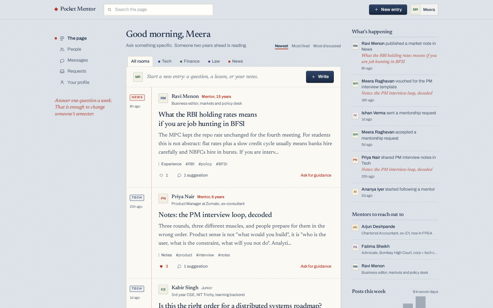
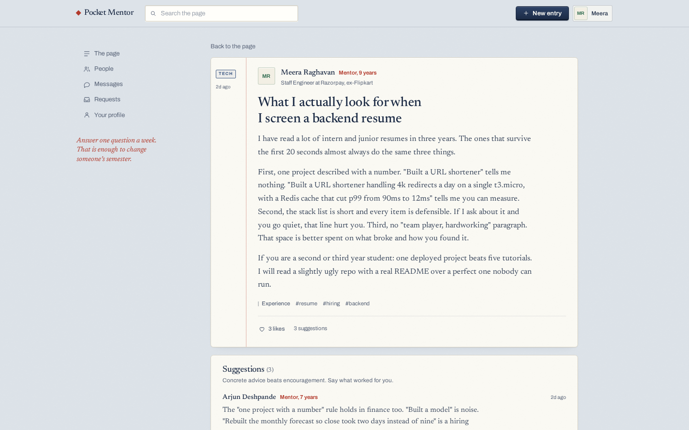
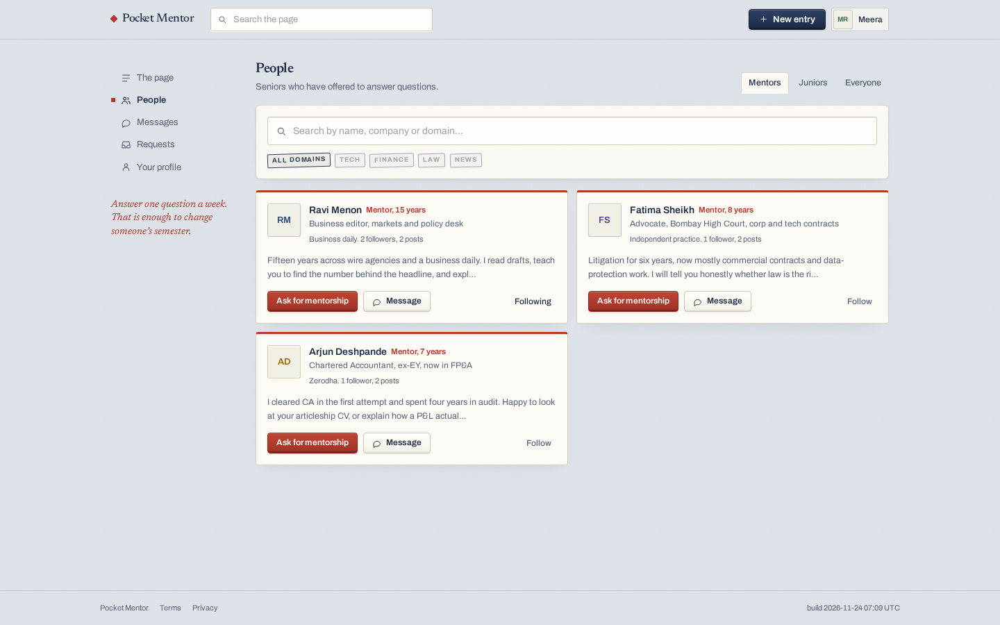
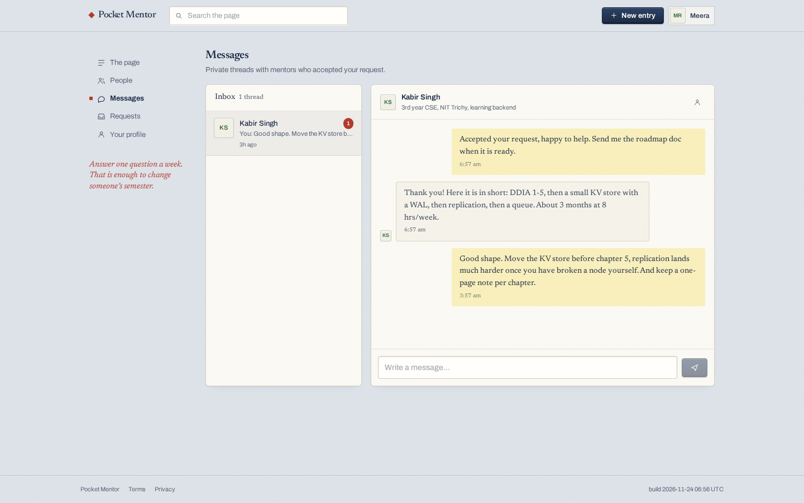
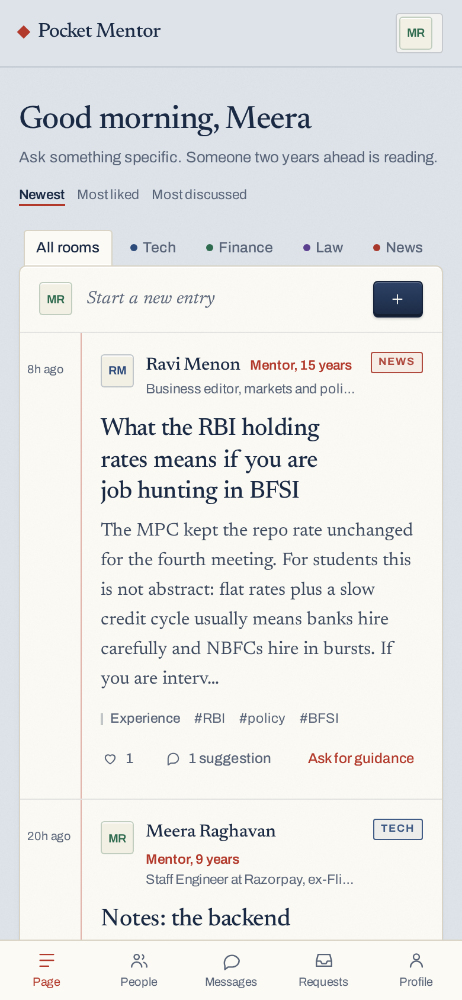

# Pocket Mentor

A mentoring platform where **seniors answer juniors** — questions, experience posts, notes and
career guidance, in four domain rooms: **Tech, Finance, Law, News**.

Built as a full-stack TypeScript app: **React Router 7 + Tailwind CSS 4 + anime.js** on the front,
**Express + TypeScript** on the back, with a file-backed JSON store so it runs with zero database
setup.

---

## What is in it

| You asked for | Where it lives |
| --- | --- |
| Login + create account | `src/pages/Login.tsx`, `src/pages/Signup.tsx`, `server/src/routes/auth.ts` (scrypt password hashing, signed JWT) |
| Post about your experience | Composer on the feed — three post kinds: **Experience**, **Question**, **Notes / resource** (`src/components/Composer.tsx`) |
| Reader can add a comment / suggestion | Suggestion thread under every post (`src/pages/PostDetail.tsx`, `POST /api/posts/:id/comments`) |
| Send a request | Mentor request with your question attached, accept / decline inbox (`src/pages/Requests.tsx`) |
| DM area | Private threads that open automatically when a mentor accepts (`src/pages/Messages.tsx`, `server/src/routes/dm.ts`) |
| Show what's happening | Live "What's happening" rail + animated weekly post chart (`src/components/ActivityRail.tsx`) |
| Domains: tech, finance, law, news | One room per domain, filterable feed + people search (`src/types.ts`, `GET /api/posts?domain=`) |
| HTML5, Tailwind, anime.js | Vite + React (HTML5 semantics), Tailwind CSS 4, anime.js for the like pop, the modal and the weekly chart |
| Terms and privacy | `/terms` and `/privacy`, written to match what the app actually stores |

Extra things included: follow / unfollow, search across posts and people, like toggles, profiles with
post history, sort by newest / most liked / most discussed, mobile bottom navigation, and a build
stamp in the footer.

### The design references, and how each one was used

1. **Motion Primitives** → the animated primitives are `src/lib/motion.ts`: `revealChildren()`
   staggers `[data-reveal]` elements into place, `pop()` springs a like button, `countUp()` runs the
   landing-page counters. Every page calls them on mount, so components feel alive without a single
   hand-written keyframe.
2. **Watermelon UI** → the landing page layout: hero with a floating product-card stack, a four-card
   domain strip, a three-step "how it works" band and a CTA panel (`src/pages/Landing.tsx`).
3. **Coconut UI** → the reusable card and button set in `src/index.css` (`.card`, `.card-hover`,
   `.btn-primary`, `.btn-ghost`, `.btn-quiet`, `.pill`, `.input`) plus `PostCard` and `Avatar`.
4. **Backlit UI** → the animated charts: the weekly bar chart in the "What's happening" rail grows
   with a staggered `scaleY`, and the stat row counts up (`src/components/ActivityRail.tsx`).
5. **anime.js** → the single animation engine behind all of the above, wrapped in
   `src/lib/motion.ts` so it works on both anime.js v3 and v4.

---

## Design

The product is juniors getting advice from seniors, so the design is built from the artifact that
carries that advice: **a senior's annotated notebook**. Not a dashboard of cards — a marked-up page
on a desk.

### Material

Paper and ink, with letterpress depth. One sheet of paper sits on a cool desk; everything readable
lives on the sheet, and the left margin of that sheet is ruled in red pen.

| Token | Value | Role |
| --- | --- | --- |
| desk | `#dde3e9` | the surface the page sits on |
| paper | `#fbfaf4` | the sheet itself, with a faint fibre texture |
| ink | `#1b2a44` | navy ballpoint, all body copy |
| pen | `#b23a2c` | the red margin rule, the asking action, errors |
| mark | `#f6e27a` | highlighter, used once per page |

Each room gets its own ink pad rather than a pastel chip: `ink-tech` navy, `ink-finance` bottle
green, `ink-law` violet, `ink-news` red.

### Type

Two families, both self-hosted through `@fontsource-variable`, so nothing waits on a font CDN.

- **Newsreader** for anything that is read: post titles, post bodies, suggestions, margin notes.
- **Archivo** for anything that is operated: navigation, buttons, labels, timestamps.

Body copy is serif at 16–17px with a 1.65–1.7 line-height and a 64-character measure. Depth of
hierarchy comes from size and position, not from colour.

### Layout

The feed is one continuous sheet, not a stack of cards:

```
┌──────────────┬───┬───────────────────────────────────┐
│  nav rail    │NEWS│ Ravi Menon   Mentor, 15 years    │
│  (desk)      │   │ What the RBI holding rates means  │
│              │8h │ ...body in serif, 64ch measure    │
│  The page  ──┤   │                                   │
│  People      │TECH│ ─────── hairline ───────          │
│  Messages    │   │ Priya Nair   Mentor, 6 years      │
└──────────────┴───┴───────────────────────────────────┘
                 ↑ red margin rule, domain stamp, time
```

The margin carries classification (which room, when). The column carries the writing. Rules
separate entries instead of shadows, and the composer sits at the top of the sheet as a blank ruled
line. Radius varies by role: 6px sheets, 4px buttons, 3px tabs and fields, 2px stamps.

### Motion

One orchestrated moment: on the landing page the red margin note writes itself in, and the room
stamp presses down onto the page. Everything else responds to a person — the like button pops, the
modal opens, the weekly bars grow once when the rail appears. No section-by-section fade-ups. All of
it respects `prefers-reduced-motion`.

### The earlier design references, and where each one landed

1. **Motion Primitives** → `src/lib/motion.ts` keeps the reusable primitives (`pop`, `countUp`,
   `stagger`, `revealChildren`), now used sparingly rather than on every section.
2. **Watermelon UI** → the landing page composition: hero copy against a live annotated page, then
   hairline-separated lists rather than a grid of identical cards.
3. **Coconut UI** → the component set in `src/index.css` (`.sheet`, `.index-card`, `.btn-*`,
   `.input`, `.stamp`, `.tab`), now one paper material instead of plastic.
4. **Backlit UI** → the animated weekly bar chart in the rail.
5. **anime.js** → the single animation engine behind all of it, wrapped so it runs on v3 and v4.

## Screens

| Feed (domain rooms, composer, live rail) | Post + suggestions |
| --- | --- |
|  |  |

| People / mentors | DM thread |
| --- | --- |
|  |  |

| Landing | Mobile |
| --- | --- |
|  |  |

More in `docs/screenshots/` — login, signup, requests, profile and the terms page.

---

## Run it

Requires **Node 20+**.

```bash
npm install
npm run dev
```

- Web: <http://localhost:5173>
- API: <http://localhost:4000>

`npm run dev` starts both (Vite proxies `/api` to the Express server).

### Five demo accounts, all with the password `demo1234`

| Email | Role | Domain |
| --- | --- | --- |
| `meera@pocket.dev` | Senior mentor | Tech (Staff Engineer, Razorpay) |
| `arjun@pocket.dev` | Senior mentor | Finance (CA, ex-EY) |
| `fatima@pocket.dev` | Senior mentor | Law (Advocate, Bombay HC) |
| `ravi@pocket.dev` | Senior mentor | News (Business editor) |
| `kabir@pocket.dev` | Junior | Tech (NIT Trichy) |

The login screen has a **"Sign in as the demo mentor"** button that signs you in as Meera.

### Production

```bash
npm run build     # builds the client into dist/web and the API into dist/server
npm start         # one Express server on :4000 serving both the API and the built client
```

### Useful scripts

| Script | Does |
| --- | --- |
| `npm run dev` | API (tsx watch) + Vite dev server together |
| `npm run build` | Client bundle + compiled server |
| `npm start` | Serve the built app from Express |
| `npm run typecheck` | `tsc --noEmit` on both client and server |
| `npm run reset:data` | Delete the JSON database so it reseeds on next boot |
| `node scripts/e2e.mjs` | 37 end-to-end API checks against a running server |
| `node scripts/shots.mjs http://localhost:4000` | Screenshots every page (needs puppeteer-core) |

---

## How it is put together

```
pocket-mentor/
├── index.html                # HTML5 shell
├── src/                      # React Router 7 client
│   ├── main.tsx              # RouterProvider + AuthProvider
│   ├── App.tsx               # route table
│   ├── index.css             # Tailwind 4 theme + the Coconut-style component set
│   ├── components/           # AppLayout, PostCard, Composer, ActivityRail, Modal, …
│   ├── context/AuthContext.tsx
│   ├── lib/{api,motion,format}.ts
│   ├── pages/                # Landing, Login, Signup, Feed, PostDetail, People, Messages, Requests, Profile
│   └── types.ts              # shared client types + domain metadata
├── server/src/               # Express + TypeScript API
│   ├── index.ts              # app wiring, static client in production
│   ├── auth.ts               # scrypt hashing + HS256 token signing
│   ├── store.ts              # atomic JSON-file persistence
│   ├── seed.ts               # five demo people, nine posts, suggestions, requests, DMs
│   ├── middleware.ts         # requireAuth / optionalAuth
│   └── routes/               # auth, users, posts, requests, dm, activity
├── scripts/{e2e,shots}.mjs   # verification scripts
└── docs/screenshots/         # rendered screenshots of every screen
```

### Data storage

Everything is persisted to `server/data/db.json` (created and seeded on first boot, written
atomically through a temp file). There is no database to install. Delete the file — or run
`npm run reset:data` — to get the demo dataset back.

### API

| Method | Route | Purpose |
| --- | --- | --- |
| `POST` | `/api/auth/signup` | Create an account, returns `{ token, user }` |
| `POST` | `/api/auth/login` | Sign in |
| `GET` / `PATCH` | `/api/auth/me` | Read or edit your profile |
| `GET` | `/api/posts` | Feed — `?domain=&kind=&q=&sort=recent\|top\|discussed` |
| `POST` | `/api/posts` | Publish a post |
| `GET` | `/api/posts/:id` | One post |
| `DELETE` | `/api/posts/:id` | Delete your own post |
| `POST` | `/api/posts/:id/like` | Toggle like |
| `GET` / `POST` | `/api/posts/:id/comments` | Read / add suggestions |
| `GET` | `/api/users` | Browse people — `?role=&domain=&q=` |
| `GET` | `/api/users/suggested` | Mentors to reach out to |
| `GET` | `/api/users/:id` | Profile + posts + your request status |
| `POST` | `/api/users/:id/follow` | Toggle follow |
| `POST` | `/api/requests` | Ask a senior for mentorship |
| `GET` | `/api/requests?box=incoming\|outgoing` | Request inbox / sent |
| `PATCH` | `/api/requests/:id` | Accept or decline (opens the DM thread) |
| `GET` | `/api/dm/conversations` | Inbox with unread counts |
| `POST` | `/api/dm/conversations` | Open (or reuse) a thread with someone |
| `GET` / `POST` | `/api/dm/conversations/:id/messages` | Read (marks read) / send |
| `GET` | `/api/activity` | "What's happening" rows |
| `GET` | `/api/activity/stats` | Totals, per-domain counts, last 7 days |
| `GET` | `/api/health` | Liveness + counts |

All authenticated routes take `Authorization: Bearer <token>`.

---

## Deploy

This is a long-running Node server that writes to a file, so it needs a host that runs a container.
Vercel does not fit: its filesystem is read-only and ephemeral, and it has no place to run the
Express server.

**Render, one click.** Push this repo, then in Render choose New → Blueprint → pick the repo → Apply.
`render.yaml` handles the rest: a Docker build, a generated `PM_SECRET`, and a health check on
`/api/health`.

**Anywhere with Docker.**

```bash
docker build -t pocket-mentor .
docker run -p 4000:4000 -e PM_SECRET=$(openssl rand -hex 32) pocket-mentor
```

On the free plan the disk is ephemeral, so the dataset reseeds on every deploy or restart and posts
made in the demo disappear. Attach a disk and set `PM_DATA_DIR=/data` to keep them.

## Configuration

| Variable | Default | Meaning |
| --- | --- | --- |
| `PORT` | `4000` | API port (the Vite dev proxy follows it) |
| `PM_SECRET` | dev fallback | HMAC secret for tokens — **set this before deploying** |
| `PM_DATA_DIR` | `server/data` | Where `db.json` lives |
| `VITE_API_BASE` | *(empty)* | Point the client at a different API origin |

Copy `.env.example` to `.env` and export the values, or pass them inline:
`PM_SECRET=$(openssl rand -hex 32) npm start`.

---

## Honest limitations

- **Polling, not websockets.** The DM thread refreshes every 5s and the inbox every 8s. Fine for a
  project, not for production scale.
- **No email verification, password reset or rate limiting.** Add those before opening it to real
  users.
- **JSON file store.** Single-process only; two API instances would fight over the file. Swap
  `server/src/store.ts` for Postgres/Mongo when you need more — the routes only use
  `getDB()` / `save()`.
- **Avatars are initials on gradients**, not uploads. There is no image upload endpoint yet.
- Seeded posts and quotes are written for this demo; the people and companies named in them are
  fictional personas.
